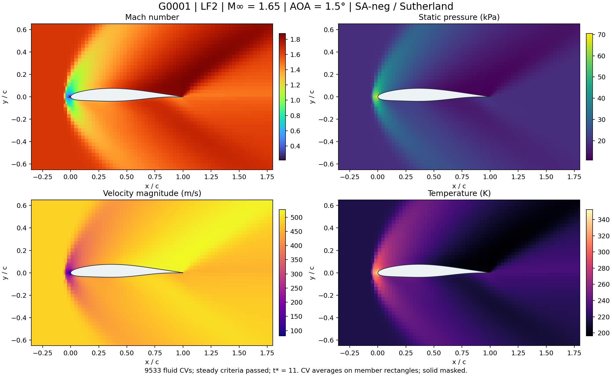

# quick_CFD_for_NNLCI_airfoil_opt_case

Start with [GUIDE.html](GUIDE.html) for the equations, algorithms, mesh presets, offline configuration editor, and output definitions. Download or clone the repository and open the guide locally in a browser.

A standalone pipeline: **GXXX point CSV → contour preparation → LF1/LF2 AMR cut-cell meshes → CPU/CUDA solver → SI fields, wall data, and aerodynamic loads**. Source code, standalone CMake configuration, the Python entry point, defaults, and ten example airfoils are included. No parent-project code or geometry is required.

## Computed flow example



Saved G0001 result: M∞=1.65, angle of attack 1.5°, p∞=18,754 Pa, T∞=216.65 K, chord 1 m; SA-neg with Sutherland viscosity and a no-slip wall. LF2 has 9,533 fluid control volumes and passed the original steady criteria. Colors show control-volume averages on background member rectangles, with the solid masked. Pressure and temperature changes follow compressible mechanical flow; thermal conductivity is zero. See the [Guide flow gallery](GUIDE.html#flows) for LF1/LF2 fields, surface Cp, and interpretation. Plot data and provenance are retained in [docs/data](docs/data).

## Quick start

Requirements: Python 3.9+, NumPy, CMake 3.18+, and C++17. GPU execution additionally requires the CUDA Toolkit and a compatible NVIDIA GPU. The default CUDA architecture is 89 for RTX 4090; specify the correct architecture when building for another GPU.

```sh
cd quick_CFD_for_NNLCI_airfoil_opt_case
python3 -m pip install -r requirements.txt
python3 quick_cfd.py build
python3 quick_cfd.py run --points examples/G0001_airfoil_points.csv --out runs/my_airfoil
```

Each input runs **both LF1 and LF2** by default. The output directory must be new or empty. Both grids start independently from uniform freestream at t=0; there is no LF1-to-LF2 warm start. Open `runs/my_airfoil/index.html` after the run.

```sh
# Generate both meshes only
python3 quick_cfd.py mesh --points examples/G0001_airfoil_points.csv --out runs/mesh_only
# Save the complete defaults, then edit the JSON
python3 quick_cfd.py init-config --out my_config.json
python3 quick_cfd.py run --points examples/G0002_airfoil_points.csv --config my_config.json
# Physical freestream, laminar flow, constant viscosity, and a selected output region
python3 quick_cfd.py run --points examples/G0001_airfoil_points.csv --mach 1.35 --aoa 5 --pressure 18754 --temperature 216.65 --turbulence none --viscosity constant --region -0.5 2 -0.5 0.5 --fields x y p mach
# Run LF2 to a specified nondimensional time without claiming steady state
python3 quick_cfd.py run --points examples/G0001_airfoil_points.csv --levels LF2 --mode time --stop-time 1
# Re-export without running the solver; the region uses x/c,y/c, while fields use SI
python3 quick_cfd.py export --run runs/my_airfoil --fields x y p mach --region -0.5 2 -0.5 0.5 --formats npz
# Build and run on CPU without CUDA
python3 quick_cfd.py build --cpu
python3 quick_cfd.py run --backend cpu --points examples/G0001_airfoil_points.csv --mode time --stop-time 0.01
```

## Defaults

| Setting | LF1 | LF2 |
|---|---|---|
| Typical fluid control volumes | 4668–4725 | 9433–9533 |
| Background cells | 42×40 | 42×40 |
| Maximum refinement level | 5 | 6 |
| Wall h/c | 1/64 | 1/128 |
| Wall buffer | 4 | 4 |

Counts depend on geometry. LF1/LF2 identify fixed refinement rules, rather than prescribed cell counts. Complete boxes and parameters are in [config/default.json](config/default.json).

Common settings: M∞=1.65, angle of attack 1.5°, p∞=18,754 Pa, T∞=216.65 K, chord 1 m; domain [-7,14]×[-10,10] in chord units. The defaults use SA-neg, Sutherland viscosity, HLLC, first-order finite volumes, SSP-RK3, CFL=.15, viscous/SA CFL=.1, and fused GPU kernels with CUDA Graph batches of 32 sequential trials. All four outer sides use characteristic farfield conditions, with pressure-outlet and transmissive alternatives. The wall is stationary and no-slip; κ=0.

## Configuration and output

- `freestream`: Mach, angle of attack, static p/T, chord, γ, and R. Input x,y represent x/c,y/c and are preserved without translation or scaling.
- `mesh`: bounds, base_shape, wall_buffer, max_cells, and LF1/LF2 refinement levels/boxes.
- `physics`: turbulence=`none|sa-neg`, viscosity=`constant|sutherland`, viscosity constants, and the SA freestream value.
- `boundaries`: separate xmin/xmax/ymin/ymax conditions. Pressure-outlet static pressure uses Pa; supersonic outflow does not impose outlet pressure.
- `solver`: CPU/CUDA, hllc/ausm, reference/fused SA layouts, CFL or fixed dt in seconds, time/budget/steady criteria, and the moment reference.
- `output`: x,y,p,rho,u,v,mach,temperature; CSV/uncompressed NPZ; regions, nearest-cell probes, surface patches, and whole-airfoil loads.

Each grid stores complete nondimensional arrays and geometry under `internal/`, with selected SI exports under `output/`. `result.json`, `solver.log`, `config.resolved.json`, and `command.json` record provenance and stopping reasons.

`output/aerodynamics.csv/.npz` contains one row per case with selectable drag, lift, fx, fy, viscous forces, moments, and CL/CD/CM_z. Choose columns with `--load-fields` or `output.load_fields`. `output/loads.json` retains pressure, viscous, and total force/moment components and patch contributions.

**Coordinates lie in the x–y plane; positive Mz is counterclockwise. The default reference is (.25c,0). Forces use N/m span and moments use N m/m span.** Wall pressure, density, and temperature are owner-cell samples; stationary no-slip wall velocity is zero. `temperature_owner_K` is not a prescribed wall temperature.

Exit codes: 0 for a completed mesh/time task or converged steady run; 2 for input/build/numerical/output errors; 3 for a steady run that has not met its criteria, with results saved. A fixed dt replaces automatic convective/viscous/SA limits; oversized values are not silently reduced to a stable choice.

## Current scope and development

The published pipeline is **2D**. It provides mechanical SA-neg/laminar flow with κ=0, without Fourier heat fluxes, wall functions, or an exposed low-Mach preconditioner. It is intended for fast, coarse-grid qualitative aerodynamic data. Temperature comes from total energy and the equation of state; high-Re boundary-layer resolution and experimental drag accuracy are not certified. See [GUIDE.html](GUIDE.html) for the methods and limitations.

Local development of a viscous SA 3D sphere solver and low-Mach preconditioning is separate from this documentation release. The requested Mach 0.2 NACA4412 and 3D sphere work will be documented with verified results when ready. See [NEXT_SESSION.md](NEXT_SESSION.md). Heat transfer follows later.

After moving the folder, the build command preserves an old-location build under a renamed directory before reconfiguring. [CORE_PROVENANCE.json](CORE_PROVENANCE.json) retains the original extraction hashes and current hashes after English comment translation. The published numerical discretization is unchanged by this translation.

Historical comparisons: [20 short-case checks](validation/ten_short_checks.json) and [full audit/timing summary](validation/summary.json). Large simulation outputs, archived references, build products, and the user's local Chinese originals are excluded from Git.
