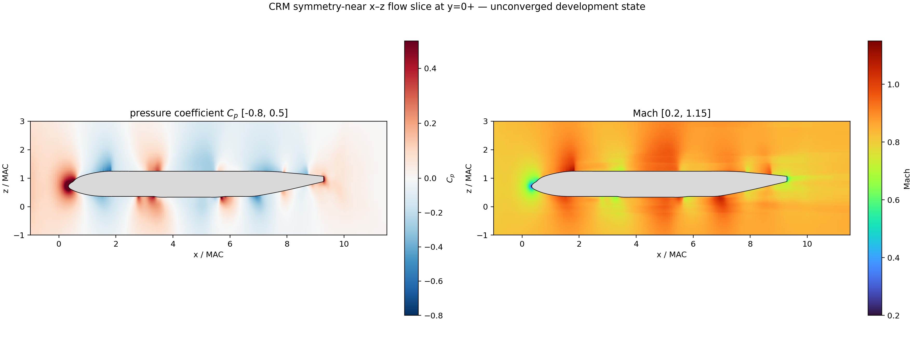

# Quick CFD: GPU-first multi-fidelity compressible CFD

Quick CFD is a GPU-oriented research code for rapidly generating qualitative
compressible-flow fields and aerodynamic trends for NNLCI and other surrogate
models.  It spans a fast two-dimensional Cartesian cut-cell airfoil path,
general three-dimensional explicit-face meshes, and a procedural Cartesian-AMR
cut-cell path for full aircraft.  The package contains source, reproducible
examples, retained settings, mesh converters, validation metadata, and a
complete English theory and operation manual.

This is a research and surrogate-data-generation code.  It is not a certified
replacement for a production CFD package.  In particular, the current CRM
states are transient development states, not converged drag-validation results.

**Accuracy validation is ongoing.**  Geometry closure, uniform-flow
preservation, positivity, restart behavior, and fixed-step CPU/CUDA agreement
have verification evidence.  The 2-D NACA4412 case has a matched XFOIL
numerical comparison.  CRM surface pressure, integrated CL/CD/CM, long-window
convergence, and grid independence are still under development.  The large
CRM timings below demonstrate GPU throughput, not time to a validated
aerodynamic answer.



## Demonstrated scale and speed

The retained CUDA measurements below were produced in the RTX 4090 development
environment.  They report actual process or solver-compute time, not an
extrapolated kernel rate.  The demonstrated Mach envelope is **0.2 through
1.65**.  This is the range exercised by the retained low-subsonic, transonic,
and supersonic cases; it is not a hard parser limit or a validation claim
outside those conditions.

| Case | Mach | Mesh size | Recorded GPU work and time | Interpretation |
|---|---:|---:|---:|---|
| NACA4412 LF1/LF2 | 0.20 | 4,718 / 9,517 controls | 20.07 / 33.09 s process time | CL/CM/Cp gate passed against the matched XFOIL numerical reference |
| RAE2822 hybrid LF1 | 0.78 | 5,051 wedge/hexa cells | 49,000 DP-LUR updates in 11.24 s compute | solver gate passed; experimental accuracy is not claimed |
| NASA CRM tetra | 0.85 | 10,067,380 tetrahedra | 5,850 DP-LUR updates in 600.20 s compute; 610.35 s total wall time | throughput demonstration; state remains unconverged |
| NASA CRM Cartesian AMR | 0.85 | 21,523,036 active controls from 31,478,784 procedural cells | 297 DP-LUR updates in 121.19 s compute | large-grid throughput demonstration; state remains unconverged |
| 3-D sphere regression | 1.65 | 7,680 polyhedral cells | retained end-to-end showcase in 2.15 s process time | coarse conservation/CPU-CUDA regression, not an accuracy benchmark |

On the 21.52M-control CRM AMR mesh, one retained update averaged about 0.408 s.
The complete final mesh build from the closed surface took about 8 min 52 s;
rebuilding the final refinement after its reusable parent took about 5 min
20 s.  These are single-case measurements, not universal runtime guarantees.

## Supported mesh representations

| Dimension | Representation | Current use |
|---|---|---|
| 2-D | structured Cartesian and quadtree AMR cut cells | LF1/LF2 airfoils with exact wall segments and small-cell treatment |
| 3-D | explicit owner/neighbour polyhedral faces | tetrahedra, wedges, hexahedra, and six-block sphere meshes |
| 3-D | procedural multi-block Cartesian octree AMR | 8x8x8 leaf blocks, exact cut faces, conservative agglomeration, and 2:1 interfaces |

The procedural path stores regular block topology implicitly and materializes
only interfaces, physical boundaries, cut-face exceptions, and wall fragments.
That design reduces face-storage and traversal cost while preserving exact
cut-surface load integration.

## Implemented paths

| Path | Mesh | Solver | Current evidence |
|---|---|---|---|
| 2-D airfoil | Cartesian cut cell, LF1/LF2 | density based, RK3, SA-neg, low-Mach preconditioning | NACA4412 CL/CM/Cp comparison |
| 3-D sphere | six-block cubed-sphere polyhedra | explicit-face CPU/CUDA | conservation, positivity, full 3-D CPU/CUDA agreement |
| 3-D RAE2822 | mixed wedge/hexa thin slab | explicit-face DP-LUR | LF1 run and CPU/CUDA agreement |
| 3-D CRM tetra | NASA body-fitted tetrahedra | explicit-face DP-LUR | 10.07M-cell import, restart, gradient and SA studies |
| 3-D CRM AMR | multi-block Cartesian octree cut cell | procedural DP-LUR | 7.66M, 14.01M, and 21.52M control-volume cases |

The solvers are density based.  A pressure-based SIMPLE/SIMPLEC/PISO algorithm
is **not implemented**.  Low-Mach preconditioning does not make a scheme
pressure based.

## Quick build

CUDA build (RTX 4090 default architecture 89):

```bash
python3 -m venv .venv
source .venv/bin/activate
pip install -r requirements.txt
cmake -S . -B build -DCMAKE_BUILD_TYPE=Release -DCFD_CUDA=ON \
  -DCMAKE_CUDA_ARCHITECTURES=89
cmake --build build -j 8
ctest --test-dir build --output-on-failure
```

CPU-only build:

```bash
cmake -S . -B build_cpu -DCMAKE_BUILD_TYPE=Release \
  -DCFD_CUDA=OFF -DCFD_OPENMP=ON
cmake --build build_cpu -j 8
ctest --test-dir build_cpu --output-on-failure
```

Run the self-contained 3-D sphere smoke case:

```bash
bash examples/3d_sphere/run_smoke.sh build_cpu cpu
```

## Documentation

- [Complete English theory and operation manual](docs/MANUAL.md)
- [Step-by-step development history](docs/DEVELOPMENT_HISTORY.md)
- [Example matrix and runbooks](examples/README.md)
- [True-mesh visual showcase](examples/README.md#visual-showcase)
- [Development status](docs/STATUS.md)
- [Next development phase](docs/STATUS.md#next-development-phase)
- [Data and binary formats](docs/FORMATS.md)
- [Literature, standards, data, and software references](docs/REFERENCES.md)

## Repository layout

- `src/`, `pipeline/`, `quick_cfd.py`: published 2-D workflow;
- `solvers/3d/`: explicit-face `sphere3d`, procedural-AMR `amr3d`, import,
  preprocessing, restart, diagnostics, and unit tests;
- `tools/cartesian_amr/`: octree planning, exact surface clipping, cut-cell
  moments, agglomeration, solver-table assembly, and packing;
- `tools/hybrid/`: RAE2822 mixed triangle/quad extrusion to wedges/hexahedra;
- `examples/`: one step-by-step runbook per retained case;
- `validation/`: lightweight validation and comparison scripts.

## External data and licensing

NASA CRM and archived RAE2822 source meshes are not bundled.  Their runbooks
record source locations, checksums where available, conversion commands, and
reference metadata.  The project owner must select a software license before a
public release; see [LICENSE_NOT_SELECTED.md](LICENSE_NOT_SELECTED.md).
